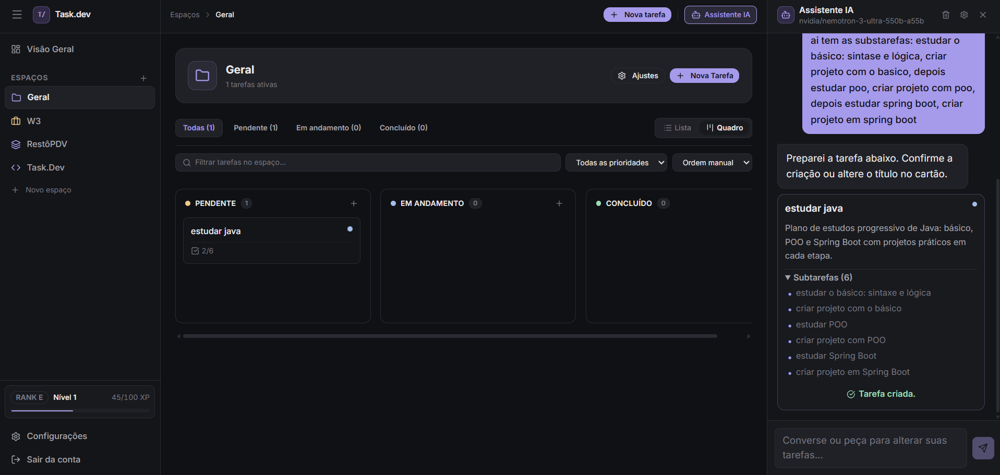
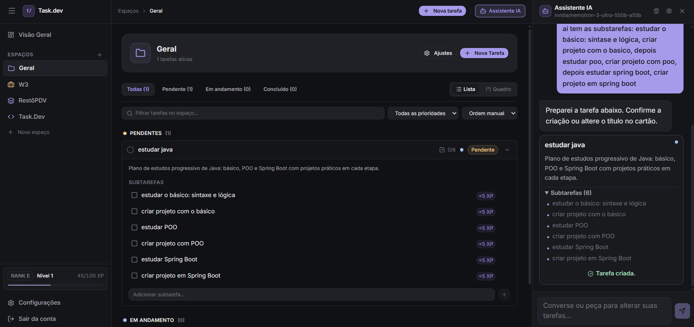
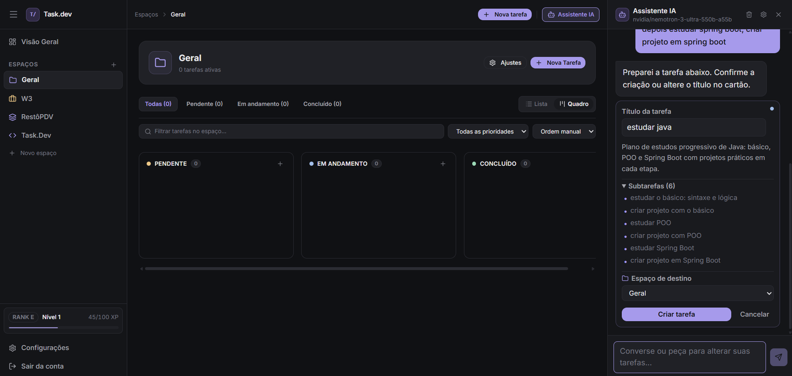
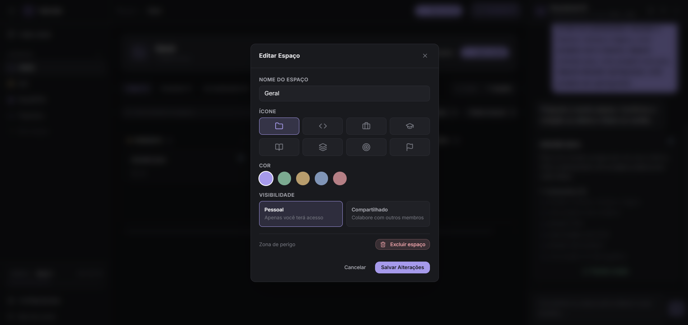

# Task.dev

**Organize seu trabalho. Acompanhe seu progresso. Construa seu próximo passo.**

Gerenciador de tarefas de código aberto para desenvolvedores e pequenas equipes, com espaços compartilhados, Kanban, listas, subtarefas, gamificação e um assistente de IA com revisão antes de aplicar mudanças.



<p align="center">
  <a href="#documentação">Documentação</a> ·
  <a href="#funcionalidades">Funcionalidades</a> ·
  <a href="#começar">Começar</a> ·
  <a href="#executar-com-docker-compose">Docker</a> ·
  <a href="#testes-e-contribuições">Contribuir</a>
</p>

## Funcionalidades

| Recurso | Como ajuda |
| --- | --- |
| Espaços pessoais e compartilhados | Separe projetos e organize a colaboração por membros |
| Lista e quadro Kanban | Acompanhe Pendente → Em andamento → Concluído |
| Tarefas e subtarefas | Defina prioridade, prazo, responsável e checklist |
| Busca, filtros e ordenação | Encontre tarefas por título, descrição, status e prioridade |
| Assistente de IA opcional | Converse, revise propostas e confirme as ações |
| XP, níveis e patentes | Visualize o progresso conforme as regras de conclusão |
| Administração | Gerencie usuários, papéis e redefinição de senhas |
| Documentação pública em `/docs` | Aprenda com guias, capturas e uma demonstração sem login |

## Documentação

O manual completo faz parte do frontend em **`/docs`**, acessível com ou sem conta. Ele inclui busca em todos os artigos, sumário, links compartilháveis, capturas ampliáveis e uma demonstração interativa que não altera dados reais.

**Para consultar localmente**, execute o frontend e abra [localhost:5173/docs](http://localhost:5173/docs). Não é necessário iniciar a API ou configurar banco para ler o manual. Em Docker, acesse [localhost:8080/docs](http://localhost:8080/docs).

| Quero… | Guia no repositório |
| --- | --- |
| Começar a usar | [Primeiros passos](TaskDev-Front/src/content/docs/primeiros-passos.md) |
| Organizar projetos e equipes | [Espaços e colaboração](TaskDev-Front/src/content/docs/espacos.md) |
| Entender tarefas e checklists | [Tarefas](TaskDev-Front/src/content/docs/tarefas.md) · [Lista e Kanban](TaskDev-Front/src/content/docs/visualizacoes.md) |
| Configurar a IA | [Assistente de IA](TaskDev-Front/src/content/docs/assistente-ia.md) |
| Entender recompensas | [XP, níveis e patentes](TaskDev-Front/src/content/docs/gamificacao.md) |
| Instalar ou publicar | [Instalação](TaskDev-Front/src/content/docs/instalacao.md) · [Deploy](TaskDev-Front/src/content/docs/deploy.md) |
| Conhecer a implementação | [Arquitetura](TaskDev-Front/src/content/docs/arquitetura.md) · [API](TaskDev-Front/src/content/docs/api.md) · [Modelo de dados](docs/architecture.md) |
| Tirar dúvidas | [FAQ](TaskDev-Front/src/content/docs/faq.md) · [Solução de problemas](TaskDev-Front/src/content/docs/solucao-de-problemas.md) |

Os artigos usam Markdown em `TaskDev-Front/src/content/docs`; o catálogo define a navegação. As capturas ficam em `TaskDev-Front/public/docs/screens`. São exemplos fornecidos pelo autor: o conteúdo do chat, os modelos e os indicadores retratam uma sessão e podem diferir do estado atual do código. Consulte o texto dos guias para as regras vigentes.

<details>
<summary><strong>Veja exemplos da experiência</strong></summary>

### Tarefas em pequenos passos



### IA com revisão antes de criar



### Espaços com identidade própria



</details>

## Tecnologias

A interface usa Vue, TypeScript e Vite. A API usa ASP.NET Core 10, Dapper e PostgreSQL. Você fornece o seu próprio banco e, se quiser usar o chat, a sua chave de um provedor de IA.

## Começar

Para conhecer a interface de documentação:

```sh
npm ci --prefix TaskDev-Front
npm run dev:front
```

Abra [a documentação](http://localhost:5173/docs) e selecione **Experimente na prática**. Para usar a aplicação completa, configure também PostgreSQL, a chave de criptografia e a API conforme as opções abaixo.

## Configuração do banco

Crie um banco PostgreSQL para o Task.dev. Na primeira inicialização, a API aplica as migrações versionadas com DbUp. Use uma conta que tenha acesso ao banco e permissão para criar os objetos do schema.

| Variável da API | Uso |
| --- | --- |
| `DATABASE_URL` | URL `postgresql://` do seu banco. Também aceita uma string de conexão Npgsql. |
| `DATABASE_URL_UNPOOLED` | Conexão opcional para migrações. Quando vazia, a API usa a conexão normal. |
| `AGENT_ENCRYPTION_KEY` | Chave estável de 32 bytes em Base64, usada para proteger as chaves dos provedores de IA no banco. |
| `Admin__BootstrapEnabled` | Habilita temporariamente a criação do primeiro administrador fora de Development. |
| `Security__SecureCookies` | Configure como `true` ao publicar a interface e a API por HTTPS. |

- **Neon**. Copie a conexão do painel **Connect**. Você pode usar a conexão com pool em `DATABASE_URL` e a direta em `DATABASE_URL_UNPOOLED`. [Documentação do Neon](https://neon.com/docs/connect/connect-from-any-app).
- **Supabase**. Copie a conexão PostgreSQL direta no painel **Connect**. Em uma rede somente IPv4, use o **Session pooler** quando a conexão direta não estiver disponível. [Documentação do Supabase](https://supabase.com/docs/guides/database/connecting-to-postgres).
- **PostgreSQL local ou outro provedor**. Informe host, porta, banco, usuário e senha. Siga os requisitos TLS do provedor. Para uma instância local sem TLS, informe `sslmode=disable` na URL.

## Executar em um único contêiner

O `Dockerfile` da raiz compila o Vue com Node.js 24, publica a API com o SDK .NET 10 e reúne ambos em uma imagem compacta do ASP.NET Runtime 10 que preserva as bibliotecas de idiomas e fusos horários. O Kestrel roda sem privilégios de root e serve a interface em `/` e a API em `/api` pela porta HTTP `8080`. Use um banco PostgreSQL externo, como Neon ou Supabase.

Com `DATABASE_URL` e `AGENT_ENCRYPTION_KEY` no `.env` da raiz, execute:

```bash
docker build -t taskdev:unified .
docker run --rm --env-file .env -e Security__SecureCookies=false -p 127.0.0.1:8080:8080 taskdev:unified
```

Abra `http://localhost:8080`. O comando desativa o atributo `Secure` para o teste HTTP local. A imagem ativa cookies seguros e desativa o Swagger por padrão. O frontend da imagem usa `/api` na mesma origem. As configurações do Vite para desenvolvimento e publicação separada continuam disponíveis pelos comandos correspondentes.

## Executar com Docker Compose

Requer Docker Engine ou Docker Desktop com Compose v2. Na raiz do repositório:

```bash
cp .env.example .env
```

Para gerar a chave da API, use `openssl rand -base64 32`. No PowerShell, use `[Convert]::ToBase64String([System.Security.Cryptography.RandomNumberGenerator]::GetBytes(32))`. Salve a chave em `AGENT_ENCRYPTION_KEY` no seu `.env`.

**Com Neon, Supabase ou outro banco externo**, preencha `DATABASE_URL` e execute:

```bash
docker compose up --build -d
```

**Com um PostgreSQL no próprio Compose**, preencha `POSTGRES_PASSWORD` com uma senha aleatória em hexadecimal, por exemplo, gerada por `openssl rand -hex 24`. Execute:

```bash
docker compose -f compose.yaml -f compose.postgres.yaml up --build -d
```

Abra [http://localhost:8080](http://localhost:8080). O Compose publica a interface no loopback. O Nginx encaminha `/api` para a API. O banco local e as chaves de sessão usam volumes.

### Primeiro administrador

Em um ambiente privado, habilite `Admin__BootstrapEnabled=true` e reaplique o mesmo comando do Compose. Crie o primeiro administrador pela API:

```bash
curl --fail-with-body --json '{"firstName":"Seu","lastName":"Nome"}' \
  http://localhost:8080/api/admin/bootstrap
```

Guarde os campos `username` e `generatedPassword` da resposta para entrar na interface. Depois, volte a opção para `false` e reaplique o Compose antes de disponibilizar a instância publicamente. Com a API rodando localmente em Development, o endpoint também fica disponível na porta `5092`.

### Imagens independentes

Os Dockerfiles também podem ser usados individualmente:

```bash
docker build -t taskdev-api TaskDev-Back/TaskDev-Back
docker build -t taskdev-web TaskDev-Front
```

A API escuta em `8080` no contêiner. A interface escuta em `80`. Em redes ou plataformas separadas, defina `TASKDEV_API_UPSTREAM` no contêiner web com a URL interna da API, sem acrescentar `/api`. Injete as variáveis privadas somente no contêiner da API.

Para usar as duas imagens com um PostgreSQL externo já configurado no seu `.env`:

```bash
docker network create taskdev
docker run -d --name api --network taskdev --env-file .env \
  -v taskdev-session-keys:/home/app/.aspnet/DataProtection-Keys taskdev-api
docker run -d --name taskdev-web --network taskdev \
  -p 127.0.0.1:8080:80 taskdev-web
```

## Executar frontend e API separadamente

Requer .NET SDK 10, Node.js 24, npm e um PostgreSQL próprio. Configure `DATABASE_URL` e `AGENT_ENCRYPTION_KEY` no `.env` da raiz, no ambiente da API ou em [User Secrets](https://learn.microsoft.com/aspnet/core/security/app-secrets). O comando `npm run dev:back` carrega automaticamente os valores não vazios do `.env`; variáveis já definidas no terminal têm prioridade. O Compose também lê esse arquivo. Ao executar `dotnet run` diretamente, configure o ambiente ou User Secrets.

Em um terminal com as credenciais configuradas, execute:

```bash
npm run dev:back
```

Os scripts npm da API usam o SDK local em `.taskdev-tools/dotnet10`, quando ele está disponível. Em outros ambientes, usam o `dotnet` do PATH.

Em outro terminal:

```bash
npm ci --prefix TaskDev-Front
npm run dev:front
```

Acesse `http://localhost:5173`. O Vite encaminha `/api` para `http://localhost:5092`. Para outro endereço da API em desenvolvimento, ajuste `VITE_API_TARGET` no arquivo local do frontend, usando [o exemplo](TaskDev-Front/.env.example).

Para publicar separadamente:

```bash
dotnet publish TaskDev-Back/TaskDev-Back/TaskDev-Back.csproj -c Release -o artifacts/api
npm run build:front
```

Sirva `TaskDev-Front/dist` com fallback de SPA para `index.html` e execute a API com `dotnet artifacts/api/TaskDev-Back.dll`. Prefira HTTPS e um proxy para `/api` no mesmo domínio da interface. Se a API ficar em outro subdomínio do mesmo site, configure `VITE_API_BASE_URL` antes do build e `FrontendUrl` na API com a origem HTTPS exata da interface.

## Segredos

Copie os arquivos `.env.example` e preencha as cópias locais ou use o gerenciador de segredos da sua plataforma. Mantenha `.env`, `app.json`, `appsettings*.json`, certificados privados e a configuração local do Neon fora do Git. Variáveis `VITE_*` são visíveis no navegador. Reserve-as para URLs e opções públicas.

Mantenha a mesma chave de criptografia ao atualizar a API. Se uma instalação antiga usava a chave de desenvolvimento padrão, gere uma chave nova e salve novamente as credenciais dos provedores de IA no painel de configurações.

## Testes e contribuições

A [pipeline de segurança](.github/workflows/security.yml) audita npm e NuGet, verifica segredos no histórico com Gitleaks e analisa C# e TypeScript com CodeQL. O Dependabot propõe atualizações semanais. Consulte a [política de segurança](SECURITY.md) e o [relatório de revisão](docs/security-review.md) para cobertura, resultados e requisitos do GitHub.

```bash
npm run test:back
npm ci --prefix TaskDev-Front
npm run build:front
```

O [workflow de CI](.github/workflows/ci.yml) roda em pushes e pull requests. Ele verifica os arquivos versionados, executa os testes da API, compila a interface e valida os dois modos Docker com PostgreSQL descartável. Para rodar a integração do contêiner unificado na raiz, use `bash scripts/unified-smoke-test.sh` em um ambiente com Docker, OpenSSL, curl e jq. O script verifica o fallback da SPA, os códigos da API, o login atrás de um proxy HTTPS e a persistência da sessão após a recriação do contêiner. As credenciais são geradas na própria execução.

Contribuições são bem-vindas por issues e pull requests. Inclua passos para reproduzir problemas e o resultado dos testes quando fizer mudanças.

## Licença

[MIT](LICENSE).
