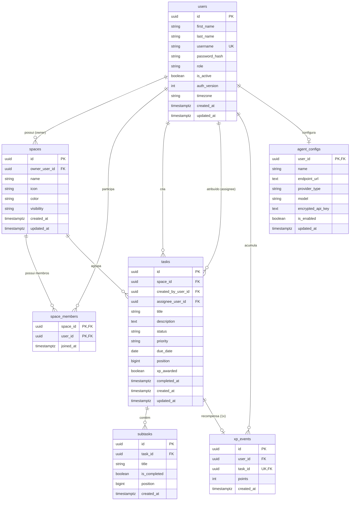

# Arquitetura e Modelo de Dados do Task.dev

## 1. Separação de Responsabilidades (Clean Architecture / Hexagonal)

O projeto segue estritamente a separação por camadas:

```
[Cliente HTTP / Frontend]
         │
         ▼
[Adapter de Entrada] ──── DTOs (Request / Response) & Minimal APIs (Endpoints)
         │               Validação, autorização e mapeamento DTO -> Model
         ▼
[Domain / Use Cases] ──── Interfaces (Ports) & Serviços de Aplicação (Services)
         │               Regras de negócio, transações, gamificação e segurança
         ▼
[Adapter de Saída]   ──── Repositórios Dapper (SQL Parametrizado) & Clientes HTTP
         │
         ▼
[PostgreSQL no Neon]
```

### Fluxo de Uma Operação:
1. **Endpoint**: Recebe a requisição HTTP, extrai o contexto do usuário através do `ISessionHandler`, valida os DTOs e invoca o serviço de domínio.
2. **Serviço**: Valida permissões (ex: se o usuário tem acesso ao espaço ou se é proprietário), aplica regras de negócio (ex: cálculo de XP, posições entre cards) e coordena a transação.
3. **Repositório**: Executa instruções SQL puras e parametrizadas via Dapper utilizando `NpgsqlConnection` e `IDbTransaction`.
4. **Retorno**: O resultado é mapeado para um DTO de resposta limpo e retornado com o código HTTP adequado (200, 201, 400, 401, 403, 404, 409).

---

### Modos de deploy

No Compose, o Vue é servido pelo Nginx e a API roda em outro contêiner. No deploy unificado, o Kestrel serve o build do Vue e a API em HTTP na porta `8080`. O fallback para `index.html` atende navegações da SPA e reserva `/api` para os endpoints do backend. O proxy público termina o TLS e o ASP.NET só interpreta cabeçalhos encaminhados dos IPs ou redes explicitamente confiáveis.

O mesmo PostgreSQL usado pela aplicação guarda o conjunto de chaves de Data Protection no modo unificado. O DbUp cria o schema `taskdev_security` para esse armazenamento. O repositório cifra o XML de cada chave antes da gravação e preserva os cookies de sessão entre recriações do contêiner. Consulte as variáveis e o procedimento de deploy no [README](../README.md#executar-em-um-único-contêiner).

## 2. Diagrama de Entidades e Relacionamentos (ERD)



---

## 3. Detalhamento das Tabelas

### 3.1 `users`
Armazena as contas de usuário do sistema.
- `username`: Gerado automaticamente a partir do nome e sobrenome, normalizado sem acentos ou caracteres especiais. Constraint `UNIQUE`.
- `password_hash`: Hash derivado com Argon2id (Konscious) usando salt criptográfico de 16 bytes.
- `role`: Perfil de acesso restrito a `ADMIN`, `OPERATOR` ou `MEMBER` via constraint `CHECK`.
- `auth_version`: Contador inteiro utilizado para invalidação imediata de sessões em resets de senha.

### 3.2 `spaces`
Espaços de trabalho organizacionais.
- `visibility`: Restrita a `PRIVATE` ou `SHARED`. Espaços pessoais só são visíveis pelo proprietário.

### 3.3 `space_members`
Tabela associativa entre usuários e espaços compartilhados.
- Chave primária composta por `(space_id, user_id)`. O proprietário não é duplicado nesta tabela.

### 3.4 `tasks`
Entidade central do sistema.
- `status`: `PENDING`, `IN_PROGRESS` ou `DONE`.
- `priority`: `LOW` (10 XP), `MEDIUM` (20 XP), `HIGH` (35 XP), `URGENT` (50 XP).
- `position`: Número inteiro de 64 bits (`BIGINT`) que dita a ordem manual estrita. O índice `idx_tasks_space_status_position` otimiza consultas em Kanban e Checklist.
- `xp_awarded`: Booleano que garante atomicamente que uma tarefa só conceda XP uma única vez.

### 3.5 `subtasks`
Itens de checklist filhos de uma tarefa principal. Excluídos em cascata se a tarefa pai for excluída.

### 3.6 `agent_configs`
Configuração de agente de IA individual por usuário. Chave de API protegida por criptografia AES-256-GCM.

### 3.7 `xp_events`
Histórico de recompensas. Possui constraint `UNIQUE` em `task_id` para garantir que nenhuma tarefa pontue mais de uma vez. A exclusão de uma tarefa não apaga o XP do usuário (ON DELETE SET NULL). O XP acumulado é calculado via `SUM(points)`.
